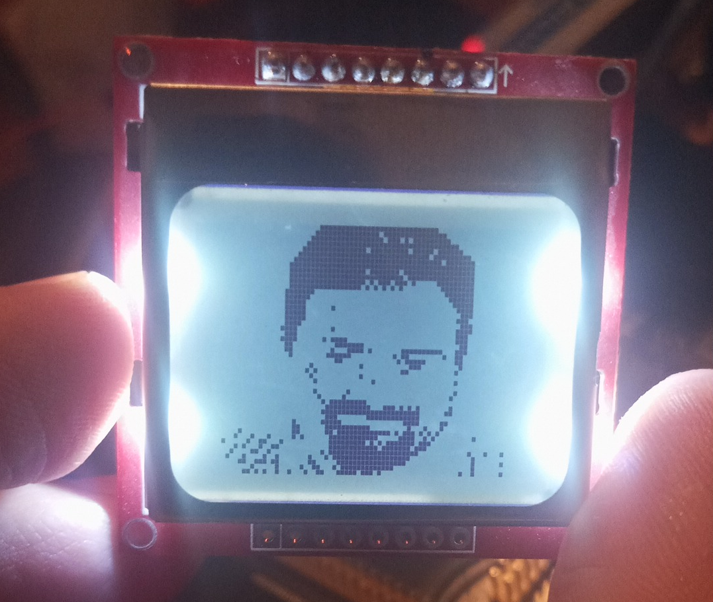
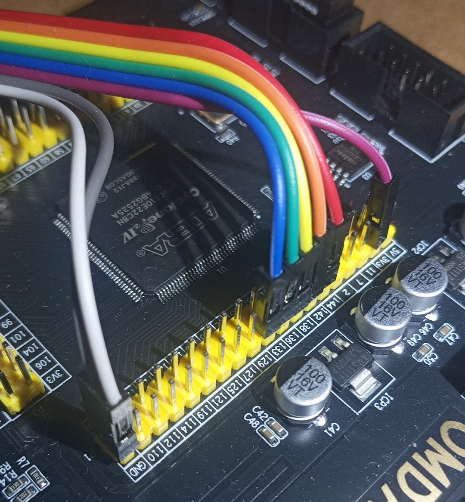
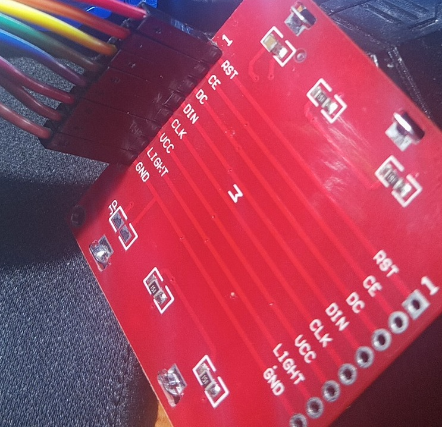
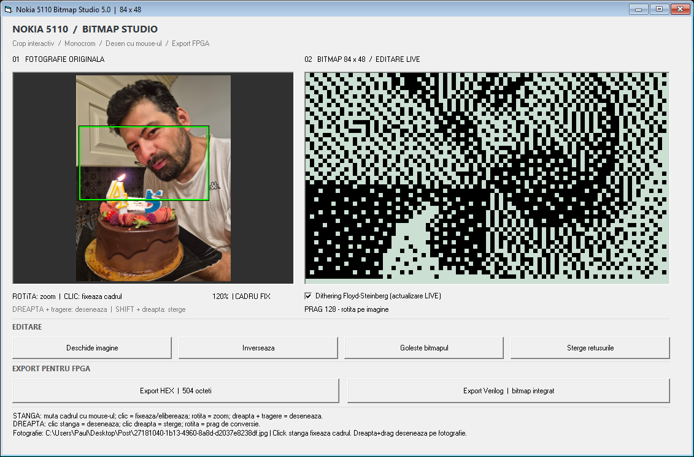
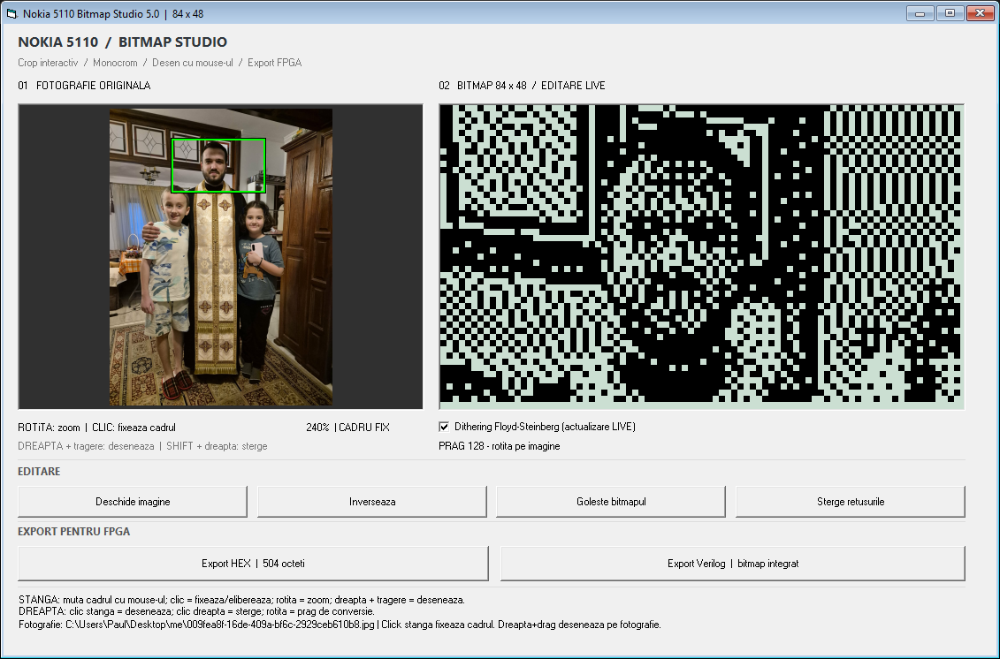

# Nokia 5110 LCD graphics on a Cyclone IV FPGA

This repository contains several implementations of a Nokia 5110 monochrome LCD controller written in Verilog, together with a Visual Basic 6 image editor used to prepare graphics for the display. The hardware projects target the **Altera Cyclone IV E EP4CE10E22C8** and a **PCD8544-based 84 × 48 pixel LCD**. All display communication is generated by the FPGA. Once programmed, the FPGA handles all communication with the LCD directly, without requiring additional hardware controllers or host-side software.



The projects cover text generated from a small character table, transmission of a complete bitmap, switching between two stored images using physical buttons, and embedding image pixels directly into Verilog as binary matrices. The alternatives have deliberately been retained as separate Quartus projects. They illustrate different ways of representing the same display data, rather than successive files that must all be compiled together.

## Contents of the repository

The supplied material is distributed in five project archives. Extract each archive into its own directory; all five use the same Quartus project name, `LCD5110`, and the same Verilog top-level module name.

| Archive / extracted directory | Implementation | Image storage | User input |
| --- | --- | --- | --- |
| `LCD5110 - TXT` | Writes **GAGNIUC** with a 5 × 7 character pattern | Character bytes defined in `LCD5110.v` | None |
| `LCD5110 - MAP` | Displays one complete 84 × 48 bitmap | `GAGNIUC_84x48.hex` | None |
| `LCD5110 MAP Cod SCURT` | More compact version of the single-bitmap controller | `GAGNIUC_84x48.hex` | None |
| `LCD5110 MAP CHANGE S1-S2` | Selects either of two complete bitmaps | `GAGNIUC_84x48.hex` and `imagine2.hex` | `S1` and `S2` |
| `LCD5110 MAP CHANGE S1-S2 MATRICE IN COD SURSA` | Selects either of two images stored as rows of binary pixels in the Verilog source | `pixeli[0:95]` in `LCD5110.v` | `S1` and `S2` |

Each extracted Quartus project contains `LCD5110.qpf`, `LCD5110.qsf`, and `LCD5110.v`. The supplied archives also preserve Quartus-generated compilation databases, reports, simulation netlists, and programming output. The relevant items are:

```text
<project directory>/
    LCD5110.qpf                 Quartus project
    LCD5110.qsf                 Device and physical pin assignments
    LCD5110.v                   Verilog display controller
    *.hex                       Bitmap data, where required
    output_files/
        LCD5110.sof             FPGA programming file
        LCD5110.fit.summary     Fitter resource summary
        LCD5110.flow.rpt        Compilation flow report
    db/                         Generated Quartus database
    incremental_db/             Generated incremental compilation data
    simulation/                 Generated simulation files
```

The single-image MAP archive additionally includes `GAGNIUC_ORIGINAL.png`, `GAGNIUC_84x48.png`, and `GAGNIUC_84x48_preview.png`, documenting the source picture and its monochrome conversion. The two button-controlled archives also contain a `VB6/` directory with the accompanying bitmap-editing software. The matrix-based archive includes the later **Nokia 5110 Bitmap Studio v7** project and sample Verilog exports.

## Display and FPGA connections

The pin assignments below are taken from the supplied `.qsf` files. They are **FPGA package pin numbers**, not the numbered contacts on the LCD module. The module's physical connector order depends on the particular Nokia 5110 board.

| FPGA signal | Cyclone IV pin | LCD connection | Purpose |
| --- | --- | --- | --- |
| `clk` | `PIN_23` | — | 50 MHz board clock |
| `lcd_rst` | `PIN_144` | RST | Display reset |
| `lcd_ce` | `PIN_142` | CE / SCE | Active-low chip enable |
| `lcd_dc` | `PIN_138` | D/C | Command/data selection |
| `lcd_din` | `PIN_136` | DIN | Serial data sent to the display |
| `lcd_clk` | `PIN_133` | CLK | Serial display clock |
| `S1` | `PIN_88` | Board pushbutton | Select first image; active LOW |
| `S2` | `PIN_89` | Board pushbutton | Select second image; active LOW |

`S1` and `S2` are used only by the two image-switching implementations. The other three designs have six top-level signals: one clock input and five LCD outputs.

<div align="center">

</div>

The Quartus assignments specify **3.3 V LVTTL** I/O. Connect the LCD ground to the FPGA board ground and power the LCD according to its module specifications, normally from a suitable 3.3 V supply. Do not assume that a bare PCD8544 module is 5 V tolerant. The LCD backlight is separate from the five control/data lines and is not driven by these Verilog modules; observe the backlight module's current-limiting requirements.

<div align="center">

</div>

These assignments are specific to the supplied EP4CE10E22C8 board setup. On another Cyclone IV board, verify the package, clock pin, actual header wiring, and button polarity before compiling or loading a programming file.

## LCD transfer format

The PCD8544 has 4,032 pixels arranged as 84 columns and 48 rows. Its display RAM is addressed in six vertical banks, each eight pixels high. A complete frame therefore requires:

```text
84 columns × 6 banks = 504 bytes
504 bytes × 8 bits   = 4,032 pixels
```

A byte represents eight vertically adjacent pixels in one column, not eight consecutive horizontal pixels. Bit 0 corresponds to the upper pixel of that eight-pixel group and bit 7 to the lower pixel. The controller transmits each byte most-significant bit first, as required by the serial interface; this does not change the PCD8544's interpretation of the individual pixel bits.

The initialization sequence used in the source is:

| Byte | Effect |
| --- | --- |
| `0x21` | Select extended instruction set |
| `0xB8` | Set operating voltage / contrast (`Vop`) |
| `0x04` | Temperature coefficient |
| `0x14` | LCD bias setting |
| `0x20` | Return to basic instruction set |
| `0x0C` | Normal display mode |
| `0x80` | Set X address to column 0 |
| `0x40` | Set Y address to bank 0 |

The sequence is sent with `lcd_dc = 0`. Bitmap and character bytes are sent with `lcd_dc = 1`. The clock and data signals are driven using counters, a shift register, and a finite-state machine in the FPGA fabric. There is no instantiated SPI IP core.

`0xB8` is the contrast value used in these particular builds; a different module may require adjustment. The code also includes a startup delay and hardware reset before transferring display data. The original MAP and TXT controllers have a longer explicit reset/release sequence. The shorter controllers release reset after approximately 20 ms and start transmission after approximately 50 ms from FPGA startup, assuming a 50 MHz clock. Once a complete frame has been transmitted, the controller stops sending data and the LCD retains its contents. These examples are not continuous video refresh engines. The two-image projects initiate another complete transfer when the selected image changes.

## The individual Verilog designs

### LCD5110 - TXT

This is the text-oriented example. Its `text_byte` function contains the five-column patterns for the letters in **GAGNIUC**, using a simple 5 × 7 character representation and zero-filled columns between letters. The text is stored in logic rather than loaded from an external font file. The controller initializes the LCD, writes 504 zero bytes to clear its RAM, moves the cursor with commands `0x95` and `0x42` (column 21, bank 2), and sends 42 character/spacer bytes. This implementation is useful for examining character generation and display positioning without introducing image-file conversion. To alter the text, the byte patterns and the final transfer count must be changed together. This is a fixed message generator, not an ASCII terminal or a general-purpose text-rendering library.

### LCD5110 - MAP

The original bitmap controller reads a 504-byte memory initialized with:

```verilog
reg [7:0] bitmap [0:503];
initial $readmemh("GAGNIUC_84x48.hex", bitmap);
```

It sends the initialization commands and then the 504 data bytes. The Verilog uses explicitly named states such as `RESET_LOW`, `RESET_HIGH`, `LOAD`, `CLOCK_UP`, `CLOCK_DOWN`, `BYTE_END`, `ADVANCE`, and `DONE`, making the transmission sequence comparatively easy to inspect. The accompanying PNG images show the graphic from which the LCD bitmap was produced. This is the most direct starting point for replacing the supplied picture with another 84 × 48 monochrome image while keeping the controller unchanged.

### LCD5110 MAP Cod SCURT

This is a shorter version of the bitmap controller. It uses the same external HEX file and eight-command initialization sequence, but compresses the transmission logic into a four-state serial sender and uses a single index from 0 to 511:

- Indices `0–7` select initialization commands.
- Indices `8–511` select the 504 bitmap bytes.

The shortened implementation is intended as a compact Verilog example. Compared with the original MAP version, several operations are combined, and the LCD clock is generated using a different state/counter arrangement. The display content is unchanged.

### LCD5110 MAP CHANGE S1-S2

This implementation keeps two independent 504-byte images in the project:

```verilog
reg [7:0] img1 [0:503], img2 [0:503];

initial begin
    $readmemh("GAGNIUC_84x48.hex", img1);
    $readmemh("imagine2.hex", img2);
end
```

The first image is selected at power-up. Pressing **S2** selects the second image; pressing **S1** returns to the first. Both buttons are active LOW and pass through two flip-flops before being used by the selection logic. The implementation does not contain a separate timed switch-debouncing circuit. A change is accepted after the preceding frame transfer has finished. When the requested image differs from the one currently displayed, the controller resumes at index 6, retransmits the X/Y address commands, and writes the selected set of 504 image bytes. There is no need to repeat the entire power-on initialization or reset the LCD on each selection. Both `.hex` files must remain available to Quartus when compiling this version. Changing either bitmap requires recompiling the FPGA design.

### LCD5110 MAP CHANGE S1-S2 MATRICE IN COD SURSA

The matrix implementation removes the dependency on external HEX images. Instead, the two full-resolution images are defined as binary rows inside the Verilog file:

```verilog
reg [83:0] pixeli [0:95];
```

Rows `0–47` describe the first image; rows `48–95` describe the second. Each row contains exactly 84 bits, with the most-significant bit representing the leftmost column. In these exported matrices, `1` is a black pixel and `0` is a white pixel. The logic converts those horizontal rows into the vertical eight-pixel bytes expected by the LCD. It calculates the current bank and column, selects the appropriate image's 48-row region, and assembles a byte from eight pixel positions:

```verilog
wire [6:0] y = {1'b0, page, 3'b000}
               + (select_img ? 7'd48 : 7'd0);
wire [6:0] xbit = 7'd83 - col;

wire [7:0] octet = {
    pixeli[y+7][xbit], pixeli[y+6][xbit],
    pixeli[y+5][xbit], pixeli[y+4][xbit],
    pixeli[y+3][xbit], pixeli[y+2][xbit],
    pixeli[y+1][xbit], pixeli[y+0][xbit]
};
```

`S1` and `S2` perform the same image selection as in the two-HEX version. The practical difference is that the entire graphic remains readable and editable in the source file as an array of `0` and `1` pixels. No separate bitmap file is needed after export. The price is a considerably longer Verilog source, including 96 rows of image data.

## Nokia 5110 Bitmap Studio (Visual Basic 6)

The `VB6/` directories contain the Windows bitmap preparation tool, supplied as Visual Basic 6 projects. The image-switching HEX project contains earlier editor layouts (v5 and v6), including compiled executables. The matrix-based project contains the later **v7 Matrice** source with additional image-storage and export functions.

<div align="center">

</div>

The editor has two working areas: the source photograph and the resulting 84 × 48 monochrome bitmap. It supports opening JPG, PNG, and BMP images, selecting a crop, zooming, changing the black/white threshold, optional Floyd–Steinberg dithering, direct pixel editing, image inversion, and clearing previously drawn corrections. The left view retains the source image; the right view shows the actual LCD-resolution pixels.

<div align="center">

</div>

Mouse operations in the supplied editor include clicking the source view to lock or unlock the cropping frame, using the wheel to change the frame size, and drawing or erasing adjustments. On the LCD preview, left-button dragging draws black pixels, right-button dragging erases them, and the wheel changes the threshold. These functions are particularly useful when a photograph must remain recognizable after reduction to only 4,032 monochrome pixels. The editor supports several distinct output paths:

| Export | Result | Suitable project |
| --- | --- | --- |
| **Export HEX** | 504 PCD8544-formatted bitmap bytes | Single-MAP or two-HEX image designs |
| **Export Verilog** | Standalone display controller with image bytes embedded in source | Projects that should not depend on `.hex` |
| **Verilog autonom – MATRICE 0/1 (imagine curenta)** (v7) | One 48 × 84 binary pixel matrix inside Verilog | Single-image matrix implementation |
| **Verilog autonom – MATRICE 0/1 (S1 + S2)** (v7) | Two matrices and button-controlled image selection inside Verilog | Two-image matrix implementation |

For the final v7 two-image workflow, prepare the first image and choose **Memoreaza imaginea S1**. Prepare the second and choose **Memoreaza imaginea S2**. Export with **Verilog autonom – MATRICE 0/1 (S1 + S2)**, save the result as `LCD5110.v`, and use that source in the Quartus project with the LCD and button pin assignments already described. No HEX data is required for that particular export. The v7 directory includes `EXEMPLU_LCD5110_doua_matrici.v` and `EXEMPLU_LCD5110_GAGNIUC_autonom.v` as examples, along with its own `README.txt`. To open the VB6 source in an existing VB6 environment, use `Nokia5110_Bitmap_Studio.vbp` and keep `frmMain.frm`, `modWheel.bas`, and the sample image assets together. The `modWheel.bas` module implements mouse-wheel handling through Windows message subclassing; close the running form normally rather than abruptly stopping execution in the VB6 IDE. The v7 archive contains project source, but does not include a compiled v7 executable in the extracted directory.

## Building and programming

Use **Quartus Prime Standard/Lite with Cyclone IV support**. The archived compilation reports identify **Quartus Prime 25.1 Standard Lite Edition** and the target `EP4CE10E22C8`; the projects are conventional Verilog designs and do not require a vendor SPI IP block.

1. Extract the desired archive, leaving its `.qpf`, `.qsf`, `.v`, and any `.hex` files together in that project directory.
2. Open `LCD5110.qpf` in Quartus, then confirm that the target device is `EP4CE10E22C8` and the top-level entity is `LCD5110`.
3. Check **Project → Add/Remove Files in Project** and add `LCD5110.v` if it is not listed. The supplied `.qsf` files contain device and pin assignments but do not explicitly contain a `VERILOG_FILE` assignment; this check matters when rebuilding from a clean extraction.
4. Verify all signal assignments in Pin Planner, especially the five LCD output pins and, for the two-image designs, `S1` and `S2`.
5. For HEX-based designs, ensure the named `.hex` data files are in the Quartus working project directory before compilation. The `$readmemh` filenames in the Verilog source must match the files actually present.
6. Run **Start Compilation**. Then open **Programmer**, select the appropriate hardware interface, and load the resulting `output_files/LCD5110.sof` into the FPGA.

A `.sof` programs the FPGA's volatile configuration; it does not by itself create a nonvolatile startup configuration. The `.sof` files included in these archives were built for the device and assignments shown above. Compile again after changing the image, source code, target FPGA, or pin mappings.

The archives include successful Quartus compilation reports. The reported logic-element utilization illustrates the differences between the variants:

| Project | Logic elements | Registers | Pins |
| --- | ---: | ---: | ---: |
| TXT | 152 | 65 | 6 |
| MAP | 328 | 62 | 6 |
| MAP Cod SCURT | 338 | 58 | 6 |
| MAP CHANGE S1-S2 | 571 | 63 | 8 |
| MAP CHANGE S1-S2 MATRICE IN COD SURSA | 592 | 73 | 8 |

All five archived fitter summaries report successful fits to the 10,320-logic-element EP4CE10E22C8. The reported embedded memory-bit count is zero for these particular synthesized designs, including those whose Verilog describes arrays of bitmap bytes. The table reflects the supplied compilation results, not new measurements or a fresh independent rebuild.

## Modifying the examples

For a replacement bitmap, first convert the image to exactly **84 × 48 monochrome pixels**. The HEX-based projects require **504 bytes** in PCD8544 page order, not an arbitrary row-by-row sequence of RGB or grayscale values. The Bitmap Studio export performs this packing. Replacing the HEX data without changing its filename is enough to change the image content in the single-image design; the FPGA must then be recompiled.

For two images, use the button-controlled HEX example when keeping the artwork in separate files is preferable. Use the matrix-based design when the intention is to inspect, modify, or generate individual pixels directly from the source. It is also possible to generate a new standalone Verilog design from the VB6 tool instead of editing the existing source by hand. The contrast byte (`0xB8`), the startup timing, and the serial clock divider are all implemented directly in Verilog and can be adjusted for experimentation. In the original MAP/TXT sender, the serial clock is approximately **500 kHz** from the 50 MHz input; the compact sender used by the later versions produces approximately **250 kHz** during bit transmission. If a display remains blank, check supply voltage, common ground, connector order, contrast, and the physical pin assignments before altering the image data. The designs are intentionally small and focused. They do not implement grayscale, a framebuffer that is modified during operation, scrolling text, a general drawing API, or externally supplied images at runtime. Image switching is between precompiled graphics held in FPGA logic. The two-button designs synchronize their inputs but do not provide full mechanical switch debouncing. There is also no standalone timing-constraint (`.sdc`) file in the supplied project archives; for a more demanding design, timing constraints and timing analysis should be added and checked explicitly. The source, bitmap assets, compiled Quartus outputs, and VB6 editor are provided together so that the complete path from picture preparation to a functioning LCD image can be studied and modified without introducing another processing device.
